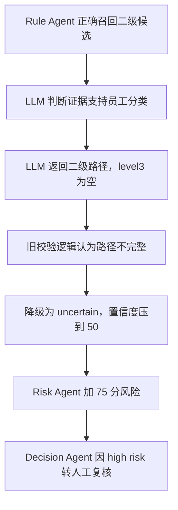

# Plan: 二级候选被 LLM 校验误降级导致人工复核的解决方案

**Generated**: 2026-07-31  
**Estimated Complexity**: Medium  
**Problem Type**: 规则召回正确，但最终审批动作错误进入人工复核  
**Scope**: 修复员工录入“细分”为二级分类，且多个分类用逗号分割时，LLM 输出合法二级路径却被系统误降级为 `uncertain`，最终被高风险规则拦截到人工复核的问题。  
**Non-Goals**: 不调整部署架构，不引入付费 API，不放宽证据质量阈值，不绕过高风险兜底。

## 背景

员工 Excel 的真实录入规则是：

```text
一级分类：必填
细分：必填
二级分类：员工 Excel 不包含这一列
```

其中“细分”列用英文逗号分割多个分类，例如：

```text
蔬菜作物,水果作物
```

这代表员工录入了两个分类：

```text
1. 蔬菜作物
2. 水果作物
```

当前系统已经可以在规则召回阶段识别：

```text
一级分类 = 种植业
细分 = 蔬菜作物,水果作物
细分粒度 = level2
候选分类 = 种植业 / 蔬菜作物 | 种植业 / 水果作物
```

但最终结果仍进入人工复核：

```text
审批动作 = 人工复核
置信度 = 50
风险分 = 75
```

这说明问题不在 Rule Agent 的候选召回，而在后续 Classification Agent、Risk Agent、Decision Agent 的联动。

## 根因分析

### 根因 1: LLM 输出校验仍按“必须三级完整路径”的旧规则执行

当前代码位置：

```text
D:\audit-agent\app\agents\llm_classification_provider.py
```

现有逻辑：

```python
matched_path = result.matched_path()
has_partial_path = any(matched_path) and not all(matched_path)

if result.matched_candidate_rule_id or not has_partial_path:
    return result

warning = "LLM 未返回完整候选规则，已降级为 uncertain。"
return result.model_copy(
    update={
        "result": "uncertain",
        "confidence": min(result.confidence, 50),
        "matched_level1": "",
        "matched_level2": "",
        "matched_level3": "",
        ...
    }
)
```

这段逻辑在旧设计中是合理的，因为旧候选规则只有：

```text
level1 / level2 / level3
```

所以只返回：

```text
种植业 / 蔬菜作物
```

确实是不完整路径。

但是现在系统已经支持：

```text
细分粒度 = level2
候选分类 = 种植业 / 蔬菜作物
```

因此当 `entered_subcategory_granularity == "level2"` 时：

```text
matched_level1 + matched_level2 有值
matched_level3 为空
```

不是错误，而是合法二级候选。

### 根因 2: 降级为 uncertain 后触发高风险兜底

当前风险评分逻辑：

```text
D:\audit-agent\app\agents\risk_agent.py
```

相关规则：

```text
classification_result.confidence < 70 => 风险 +35
classification_result.result == "uncertain" => 风险 +40
```

因此一旦 LLM 合法二级输出被降级成：

```text
result = uncertain
confidence = 50
```

风险分会变成：

```text
35 + 40 = 75
```

风险等级变成 `high`。

### 根因 3: Decision Agent 对 high risk 做强制人工复核

当前最终决策逻辑：

```text
D:\audit-agent\app\domain\decisions.py
```

相关规则：

```text
if risk_level == "high":
    return DecisionAction.NEEDS_HUMAN_REVIEW
```

所以最终链路变成：



## 目标行为

### 场景 1: 单个二级分类

员工录入：

```text
一级分类 = 种植业
细分 = 蔬菜作物
```

召回结果：

```text
细分粒度 = level2
候选分类 = 种植业 / 蔬菜作物
```

如果证据支持蔬菜种植，则期望：

```text
Classification result = supports_entered_category
confidence >= 80
risk_score < 40
审批动作 = 自动通过
```

### 场景 2: 多个二级分类，用逗号分割

员工录入：

```text
一级分类 = 种植业
细分 = 蔬菜作物,水果作物
```

召回结果：

```text
细分粒度 = level2
候选分类 = 种植业 / 蔬菜作物 | 种植业 / 水果作物
```

如果证据同时支持蔬菜和水果业务，则期望：

```text
Classification result = supports_entered_category
confidence >= 80
risk_score < 40
审批动作 = 自动通过
```

如果证据只支持蔬菜，不支持水果，则期望：

```text
Classification result = uncertain 或 conflicts_with_entered_category
审批动作 = 人工复核或驳回
原因说明：证据未覆盖员工录入的全部细分分类
```

### 场景 3: 三级分类仍保持严格校验

员工录入：

```text
一级分类 = 卫生和社会工作
细分 = 专科医院
```

召回结果：

```text
细分粒度 = level3
候选分类 = 卫生和社会工作 / 医院 / 专科医院
```

如果 LLM 只返回：

```text
卫生和社会工作 / 医院
```

仍应被认为是不完整路径，因为员工录入的是三级分类，证据必须支持具体三级分类。

## 最优解决方案

### 方案核心

不要取消高风险兜底，也不要简单降低风险分。

最优方案是：

```text
让 LLM 输出校验逻辑理解候选粒度。
```

也就是：

```text
level2 输入：允许二级路径合法存在
level3 输入：仍要求三级路径完整
mixed / ambiguous / unknown：继续人工复核
```

## Sprint 1: 修复细分逗号拆分规则

**Goal**: 明确员工“细分”列只用逗号分割多个分类，避免使用过宽分隔符导致误拆。  
**Demo/Validation**:

- `蔬菜作物,水果作物` 被拆成两个分类。
- `蔬菜作物，水果作物` 可兼容中文逗号。
- 不再用 `/` 拆分员工细分，避免和候选路径展示符冲突。

### Task 1.1: 收敛细分分隔符正则

- **Location**: `D:\audit-agent\app\services\rule_retriever.py`
- **Description**: 将员工细分拆分逻辑明确为“逗号分隔”。建议支持英文逗号和中文逗号，其他分隔符仅作为脏数据兼容时再单独讨论。
- **Dependencies**: 无
- **Acceptance Criteria**:
  - `"蔬菜作物,水果作物"` => `["蔬菜作物", "水果作物"]`
  - `"蔬菜作物，水果作物"` => `["蔬菜作物", "水果作物"]`
  - `"种植业 / 蔬菜作物"` 不会被拆成两个细分值
- **Validation**:
  - 新增测试：`test_split_entered_subcategories_uses_comma_separator`

### Task 1.2: 统一 Rule Retriever 和 Classification Agent 的拆分函数

- **Location**:
  - `D:\audit-agent\app\services\rule_retriever.py`
  - `D:\audit-agent\app\agents\classification_agent.py`
- **Description**: 当前两个模块各自维护分隔符正则，容易产生不一致。建议把拆分函数放到一个共享位置，例如 `D:\audit-agent\app\services\category_text.py`。
- **Dependencies**: Task 1.1
- **Acceptance Criteria**:
  - 规则召回和分类判断使用同一套拆分逻辑
  - 不同模块对 `蔬菜作物,水果作物` 的理解完全一致
- **Validation**:
  - 更新 `test_rule_retriever.py`
  - 更新 `test_classification_agent.py`

## Sprint 2: 让 LLM 输出校验支持二级候选

**Goal**: 修复合法二级路径被误降级为 `uncertain` 的根因。  
**Demo/Validation**:

- `level2` 粒度下，`matched_level1 + matched_level2` 合法。
- `level3` 粒度下，仍要求完整三级路径。

### Task 2.1: 改造 `_normalize_candidate_rule_result`

- **Location**: `D:\audit-agent\app\agents\llm_classification_provider.py`
- **Description**: 给 `_normalize_candidate_rule_result` 增加 `candidate_rules` 参数，让它能根据 `entered_subcategory_granularity` 判断“部分路径”是否合法。
- **Dependencies**: Sprint 1
- **Acceptance Criteria**:
  - 如果 `entered_subcategory_granularity == "level2"`，并且 LLM 返回的 `matched_level1/matched_level2` 命中 `category_candidates` 中的二级候选，则不降级
  - 如果 `entered_subcategory_granularity == "level3"`，缺少 `matched_level3` 仍降级为 `uncertain`
  - 如果 `entered_subcategory_granularity in {"mixed", "ambiguous", "unknown"}`，仍保持 `uncertain`
- **Validation**:
  - 新增测试：`test_normalize_allows_partial_path_for_level2_candidate`
  - 保留测试：`test_openai_provider_downgrades_partial_legacy_path_to_uncertain`

### Task 2.2: 改造 `_validate_candidate_rule`

- **Location**: `D:\audit-agent\app\agents\llm_classification_provider.py`
- **Description**: 现有 `_validate_candidate_rule` 只校验完整三级 `candidate_rules.candidates`。需要增加对 `category_candidates` 的校验。
- **Dependencies**: Task 2.1
- **Acceptance Criteria**:
  - 二级候选路径 `种植业 / 蔬菜作物 / ""` 可以通过校验
  - 二级候选必须来自 `candidate_rules.category_candidates`
  - 不允许 LLM 编造不存在的二级分类
  - 三级候选仍必须来自 `candidate_rules.candidates`
- **Validation**:
  - 新增测试：`test_validate_candidate_rule_accepts_level2_category_candidate`
  - 新增测试：`test_validate_candidate_rule_rejects_unknown_level2_category`

### Task 2.3: 调整调用顺序和函数签名

- **Location**: `D:\audit-agent\app\agents\llm_classification_provider.py`
- **Description**: 当前调用顺序是：

```python
result = SemanticClassificationResult.model_validate(raw_data)
result = _normalize_candidate_rule_result(result)
_validate_candidate_rule(result, candidate_rules)
result = _hydrate_matched_rule_path(result, candidate_rules)
```

建议改为：

```python
result = SemanticClassificationResult.model_validate(raw_data)
result = _normalize_candidate_rule_result(result, candidate_rules)
_validate_candidate_rule(result, candidate_rules)
result = _hydrate_matched_rule_path(result, candidate_rules)
```

- **Dependencies**: Task 2.1、Task 2.2
- **Acceptance Criteria**:
  - 所有 LLM 输出归一化逻辑都能读取候选粒度
  - 不破坏现有通过 `matched_candidate_rule_id` 回填完整路径的逻辑
- **Validation**:
  - 运行 `tests\unit\test_llm_classification_provider.py`

## Sprint 3: 增强多分类语义结果表达

**Goal**: 对 `蔬菜作物,水果作物` 这种多个逗号分隔分类，避免只验证其中一个就自动通过。  
**Demo/Validation**:

- 证据支持全部录入分类时自动通过。
- 证据只支持部分录入分类时不自动通过。

### Task 3.1: 给分类候选增加稳定 ID

- **Location**:
  - `D:\audit-agent\app\domain\models.py`
  - `D:\audit-agent\app\agents\llm_classification_provider.py`
- **Description**: 为 `category_candidates` 生成稳定 ID，例如：

```text
category_1 = 种植业 / 蔬菜作物
category_2 = 种植业 / 水果作物
```

- **Dependencies**: Sprint 2
- **Acceptance Criteria**:
  - prompt 中展示 `category_1`、`category_2`
  - LLM 可以基于这些 ID 表达支持了哪些员工录入分类
- **Validation**:
  - 新增测试：`test_prompt_includes_category_candidate_ids`

### Task 3.2: 扩展 LLM 结果字段

- **Location**: `D:\audit-agent\app\agents\llm_classification_provider.py`
- **Description**: 在 `SemanticClassificationResult` 中增加可选字段：

```python
matched_category_candidate_ids: list[str] = Field(default_factory=list)
unsupported_entered_values: list[str] = Field(default_factory=list)
```

- **Dependencies**: Task 3.1
- **Acceptance Criteria**:
  - 对多个逗号分隔分类，LLM 可以返回多个 `category_*` ID
  - 如果某些员工录入分类没有证据支持，放入 `unsupported_entered_values`
  - 旧字段 `matched_candidate_rule_id` 继续兼容三级规则
- **Validation**:
  - 新增测试：`test_semantic_result_supports_multiple_category_candidate_ids`

### Task 3.3: 多分类自动通过规则

- **Location**:
  - `D:\audit-agent\app\agents\classification_agent.py`
  - `D:\audit-agent\app\agents\llm_classification_provider.py`
- **Description**: 当员工细分拆分出多个分类时，自动通过必须满足全部分类被支持。
- **Dependencies**: Task 3.2
- **Acceptance Criteria**:
  - `蔬菜作物,水果作物` 两个分类都被证据支持 => `supports_entered_category`
  - 只支持 `蔬菜作物`，不支持 `水果作物` => 不自动通过
  - reason 中明确列出未被证据覆盖的分类
- **Validation**:
  - 新增测试：`test_level2_multi_subcategories_require_all_values_supported`

## Sprint 4: 调整 Prompt，减少 LLM 输出不完整路径

**Goal**: 从提示词层面告诉 LLM 二级候选是合法输出，减少后处理纠错。  
**Demo/Validation**:

- level2 场景下，LLM 返回二级候选 ID 或二级路径。
- level3 场景下，LLM 返回完整三级规则 ID。

### Task 4.1: 明确 prompt 中的二级输出规则

- **Location**: `D:\audit-agent\app\agents\llm_classification_provider.py`
- **Description**: 在 prompt 规则中补充：

```text
如果细分粒度为 level2：
- 员工录入的每个逗号分隔值都是一个二级候选
- 证据支持该二级分类即可认为支持该员工录入值
- matched_level3 可以为空
- 优先返回 matched_category_candidate_ids
```

- **Dependencies**: Sprint 3
- **Acceptance Criteria**:
  - prompt 明确说明 level2 不需要 matched_level3
  - prompt 明确说明多个逗号分隔分类必须逐个判断
- **Validation**:
  - 单元测试断言 prompt 包含关键规则

### Task 4.2: 保持三级输出严格规则

- **Location**: `D:\audit-agent\app\agents\llm_classification_provider.py`
- **Description**: 保留现有三级限制：

```text
如果细分粒度为 level3，证据必须支持具体三级分类，不能只因命中二级分类名就通过。
```

- **Dependencies**: Task 4.1
- **Acceptance Criteria**:
  - level3 缺少 `matched_level3` 仍降级为 `uncertain`
  - LLM 编造候选外三级分类仍报错或降级
- **Validation**:
  - 现有三级候选相关测试继续通过

## Sprint 5: 风险评分保持兜底，但避免误加分

**Goal**: 不直接降低高风险策略，而是让正确的二级支持结果不再被误判为高风险。  
**Demo/Validation**:

- 合法二级自动通过场景风险分应低于 40。
- 真正 uncertain 场景仍进入人工复核。

### Task 5.1: 增加回归测试覆盖完整链路

- **Location**:
  - `D:\audit-agent\tests\unit\test_llm_classification_provider.py`
  - `D:\audit-agent\tests\unit\test_audit_workflow.py`
  - `D:\audit-agent\tests\integration`
- **Description**: 构造截图复现场景：

```text
一级分类 = 种植业
细分 = 蔬菜作物,水果作物
候选分类 = 种植业 / 蔬菜作物 | 种植业 / 水果作物
证据 = 同时支持蔬菜种植和水果种植
```

- **Dependencies**: Sprint 4
- **Acceptance Criteria**:
  - Classification result 不再是 `uncertain`
  - confidence 不被压到 50
  - risk_score 不再等于 75
  - final action 为 `approved`
- **Validation**:
  - 新增测试：`test_level2_multi_category_supported_result_is_auto_approved`

### Task 5.2: 保留 Decision Agent 的 high risk 人工复核规则

- **Location**: `D:\audit-agent\app\domain\decisions.py`
- **Description**: 不建议删除：

```python
if risk_level == "high":
    return DecisionAction.NEEDS_HUMAN_REVIEW
```

这条规则仍然是企业审批系统的安全兜底。

- **Dependencies**: Task 5.1
- **Acceptance Criteria**:
  - 真实 high risk 仍人工复核
  - 合法二级支持结果不再因为错误降级变成 high risk
- **Validation**:
  - 现有 `decisions.py` 相关测试继续通过

## 测试策略

### Unit Tests

重点测试：

```text
1. 细分逗号拆分
2. 二级粒度下允许 matched_level3 为空
3. 三级粒度下不允许 matched_level3 为空
4. 多个逗号分隔分类必须全部被证据支持
5. LLM 不允许编造候选外二级或三级分类
```

建议命令：

```powershell
D:\audit-agent\.venv\Scripts\python.exe -m pytest tests\unit\test_rule_retriever.py
D:\audit-agent\.venv\Scripts\python.exe -m pytest tests\unit\test_llm_classification_provider.py
D:\audit-agent\.venv\Scripts\python.exe -m pytest tests\unit\test_classification_agent.py
```

### Integration Tests

重点测试：

```text
1. 上传包含“蔬菜作物,水果作物”的 Excel
2. 官网证据同时支持蔬菜和水果
3. 最终审批动作为 approved
4. 导出 Excel 中不再出现“LLM 未返回完整候选规则，已降级为 uncertain”
```

建议命令：

```powershell
D:\audit-agent\.venv\Scripts\python.exe -m pytest tests\integration
```

### Full Verification

最终合并前运行：

```powershell
D:\audit-agent\.venv\Scripts\python.exe -m pytest
D:\audit-agent\.venv\Scripts\python.exe -m ruff check .
D:\audit-agent\.venv\Scripts\python.exe scripts\run_eval.py --min-accuracy 0.8
```

## 验收标准

完成后需要满足：

```text
1. 员工细分使用逗号分割多个分类
2. level2 候选允许 matched_level3 为空
3. level3 候选仍必须返回完整三级路径
4. 蔬菜作物,水果作物 这种多分类需要全部被证据支持才能自动通过
5. 合法二级候选不再被降级为 uncertain
6. 合法二级候选不再因为 confidence=50 被 Risk Agent 打成高风险
7. 导出结果不再错误展示“LLM 未返回完整候选规则”
8. 真实证据不足、unknown、mixed、ambiguous 仍进入人工复核
```

## 推荐实施顺序

建议按以下顺序做：

```text
1. 先写截图场景的回归测试
2. 修正细分逗号拆分规则
3. 修改 LLM 输出归一化逻辑，允许 level2 二级路径
4. 修改候选校验逻辑，支持 category_candidates
5. 增强多逗号分类的全部支持校验
6. 调整 prompt，减少 LLM 后续误输出
7. 跑全量测试和 eval
```

## Rollback Plan

如果修复后出现误自动通过，可以这样回滚：

```text
1. 临时关闭 level2 自动通过，所有 level2 进入人工复核
2. 保留逗号拆分和诊断字段，方便继续排查
3. 回退 LLM schema 扩展字段，但保留已有旧字段兼容
4. 保留 Decision Agent high risk 兜底规则
```

## 结论

这次问题的本质不是候选召回失败，而是：

```text
系统已经支持二级候选，
但 LLM 输出校验仍按三级完整路径校验。
```

因此最优修复不是降低风险分，也不是取消人工复核规则，而是让 LLM 校验逻辑理解：

```text
当细分粒度是 level2 时，
level1 + level2 就是一条完整合法候选。
```

同时，由于员工“细分”列用逗号分割多个分类，自动通过必须验证逗号拆出的每一个分类都被证据支持，不能只命中其中一个就放行。
