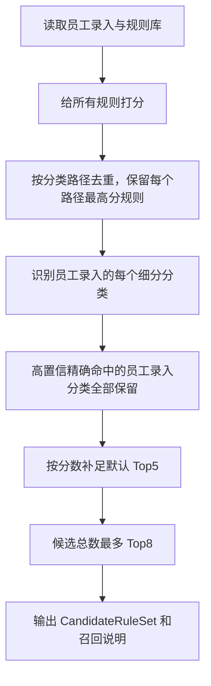

# Plan: 规则召回去重与动态 TopK 优化

**Generated**: 2026-07-30  
**Estimated Complexity**: Medium  
**Scope**: 解决 `Top 3` 候选规则可能被重复分类占满的问题，并实现动态召回策略：默认 `Top5`，高置信精确命中时保留全部员工录入分类，最多限制 `Top8`。

## Overview

当前规则召回入口在 `D:\audit-agent\app\services\rule_retriever.py`：

```python
matched_rules.sort(key=lambda item: item.score, reverse=True)
top_rules = matched_rules[:limit]
```

这个实现有三个核心问题：

1. **只按分数截断，不做分类路径去重**  
   真实规则库 `D:\audit-agent\data\rules\category_rules.json` 中有 `1195` 条规则，其中 `432` 个分类路径存在重复。例如同一个 `电力 / 发电工程 / 水电` 可能出现多条规则。当前 Top3 可能被同一个分类路径的多个重复规则占满，导致真正需要给 LLM 判断的其他候选分类进不来。

2. **员工录入多个细分分类时，没有“全量保留”保护**  
   员工可能在一个单元格中录入多个细分分类，例如 `企事业单位治安保卫,安全技术防范,人力防范`。当前召回只看整体分数，Top3 可能只覆盖其中一个细分分类，后续 LLM 会误以为候选规则不完整。

3. **固定 Top3 太小，和 LLM 判断任务不匹配**  
   Top3 对简单单分类够用，但对多细分、规则重复、一级分类近义、二级缺失的场景太窄。直接扩大到很大又会增加 prompt 长度和 LLM 干扰，所以需要动态 TopK。

本方案将规则召回改为“先去重、再保护员工录入命中、最后动态补足候选”的三段式流程：



## Target Behavior

### 目标 1: 去重

同一个分类路径只保留一条候选规则：

```text
level1 + level2 + level3 作为唯一键
```

如果多个规则路径相同：

- 保留分数最高的一条。
- 分数相同时，保留关键词更多的一条。
- 仍相同时，保留原始规则库中位置更靠前的一条，保证结果稳定。

### 目标 2: 默认 Top5

没有特殊情况时，召回最多 `5` 个不同分类路径，替代当前默认 `3` 个。

### 目标 3: 高置信精确命中时保留全部员工录入分类

如果员工录入了多个细分分类，并且这些细分分类能在规则库中精确命中，则这些命中的分类必须全部进入候选集，不受默认 Top5 影响。

例如员工录入：

```text
一级分类：安保服务
细分分类：企事业单位治安保卫,人力防范,安全技术防范
```

规则库中存在：

```text
安保服务 / 安全服务 / 企事业单位治安保卫
安保服务 / 安全服务 / 人力防范
安保服务 / 技术防范 / 安全技术防范
```

则这三条都必须保留。

### 目标 4: 最多 Top8

候选规则总数最多 `8` 条，避免 prompt 过长和 LLM 注意力分散。

如果精确命中的员工录入分类已经超过 `8` 条：

- 优先保留全部“员工录入分类路径精确命中”的规则，最多 `8` 条。
- 在召回原因中明确写出“员工录入分类超过 Top8，已截断”。
- 建议后续进入人工复核或拆分录入单元格。

## Core Algorithm

建议新增一个内部配置对象，避免到处传裸数字：

```python
@dataclass(frozen=True)
class RuleRecallConfig:
    default_top_k: int = 5
    max_top_k: int = 8
    exact_match_score_threshold: int = 7
```

召回流程：

1. 对全部规则打分，得到 `ScoredRule`。
2. 过滤 `score > 0` 的规则。
3. 对规则按 `(level1, level2, level3)` 去重。
4. 拆分员工录入细分分类。
5. 找出“高置信精确命中”的员工录入分类：
   - `entered_level1 == rule.level1`
   - 如果员工填写了 `entered_level2`，则 `entered_level2 == rule.level2`
   - `entered_subcategory` 的某个拆分值等于 `rule.level2` 或 `rule.level3`
   - 分数达到 `exact_match_score_threshold`
6. 先放入所有精确命中规则。
7. 再从剩余高分规则中补足到 `default_top_k`。
8. 如果精确命中数量大于 `default_top_k`，允许超过 Top5，但最多 `max_top_k=8`。
9. 输出候选规则和召回原因。

候选数量规则：

```text
target_size = max(default_top_k, exact_match_count)
target_size = min(target_size, max_top_k)
```

## Prerequisites

- 项目路径：`D:\audit-agent`
- 主要涉及文件：
  - `D:\audit-agent\app\services\rule_retriever.py`
  - `D:\audit-agent\app\agents\rule_agent.py`
  - `D:\audit-agent\app\workflow\nodes.py`
  - `D:\audit-agent\app\services\pipeline_service.py`
  - `D:\audit-agent\app\domain\models.py`
  - `D:\audit-agent\tests\unit\test_rule_retriever.py`
  - `D:\audit-agent\tests\unit\test_rule_agent.py`
  - `D:\audit-agent\tests\unit\test_audit_workflow.py`
- 验证命令：
  - `D:\audit-agent\.venv\Scripts\python.exe -m pytest`
  - `D:\audit-agent\.venv\Scripts\python.exe -m ruff check .`
  - `D:\audit-agent\.venv\Scripts\python.exe scripts\run_eval.py --min-accuracy 0.8`

## Sprint 1: 建立可验证的问题复现

**Goal**: 用测试固定当前问题，证明 Top3 会被重复分类占满，并证明多细分分类会漏召回。

**Demo/Validation**:

- 新增测试在旧逻辑下失败。
- 测试能清楚表达业务问题，而不是只测实现细节。

### Task 1.1: 增加重复分类占满 TopK 的测试

- **Location**: `D:\audit-agent\tests\unit\test_rule_retriever.py`
- **Description**: 构造 5 条规则，其中前 3 条是同一个分类路径的重复规则，另外 2 条是不同分类路径。员工录入和公司名让重复规则都得高分。
- **Dependencies**: 无
- **Acceptance Criteria**:
  - 调用 `retrieve_candidate_rules(..., limit=3)` 或新默认配置后，返回结果中同一路径只出现一次。
  - 返回候选应至少包含 3 个不同分类路径。
- **Validation**:
  - 测试名建议：`test_retrieve_candidate_rules_deduplicates_same_category_path_before_topk`

### Task 1.2: 增加多细分分类全量保留测试

- **Location**: `D:\audit-agent\tests\unit\test_rule_retriever.py`
- **Description**: 构造员工录入多个细分分类，规则库中每个细分都存在精确命中，同时再加入一些高分干扰规则。
- **Dependencies**: 无
- **Acceptance Criteria**:
  - 员工录入的每个精确命中分类都进入候选集。
  - 即使候选数量超过默认 Top5，只要不超过 Top8，都应保留。
- **Validation**:
  - 测试名建议：`test_retrieve_candidate_rules_keeps_all_exact_entered_subcategories`

### Task 1.3: 增加 Top8 上限测试

- **Location**: `D:\audit-agent\tests\unit\test_rule_retriever.py`
- **Description**: 构造员工录入 10 个细分分类，规则库中都能精确命中。
- **Dependencies**: 无
- **Acceptance Criteria**:
  - 返回候选数不超过 8。
  - `retrieval_reason` 中说明已超过最大候选数并被截断。
- **Validation**:
  - 测试名建议：`test_retrieve_candidate_rules_caps_dynamic_recall_at_top8`

## Sprint 2: 规则召回核心算法改造

**Goal**: 在 `rule_retriever` 内实现去重、精确命中保护、动态 TopK。

**Demo/Validation**:

- Sprint 1 新增测试通过。
- 原有规则召回测试仍通过。

### Task 2.1: 扩展 ScoredRule，保留原始索引

- **Location**: `D:\audit-agent\app\services\rule_retriever.py`
- **Description**: 给 `ScoredRule` 增加 `original_index: int`，用于去重时稳定排序。
- **Dependencies**: Sprint 1
- **Acceptance Criteria**:
  - `_score_rule()` 或调用方能生成带原始索引的 `ScoredRule`。
  - 不改变外部返回模型。
- **Validation**:
  - 运行 `test_rule_retriever.py`。

### Task 2.2: 新增分类路径去重函数

- **Location**: `D:\audit-agent\app\services\rule_retriever.py`
- **Description**: 新增 `_deduplicate_scored_rules(scored_rules)`。
- **Dependencies**: Task 2.1
- **Acceptance Criteria**:
  - 同一个 `(level1, level2, level3)` 只保留一条。
  - 优先级为：分数高 > 关键词数量多 > 原始顺序靠前。
  - 去重后顺序仍按分数从高到低。
- **Validation**:
  - 新增私有行为测试，或通过公开 `retrieve_candidate_rules()` 测试覆盖。

### Task 2.3: 新增员工录入精确命中识别

- **Location**: `D:\audit-agent\app\services\rule_retriever.py`
- **Description**: 新增 `_find_exact_entered_matches(audit_case, deduped_rules, threshold)`。
- **Dependencies**: Task 2.2
- **Acceptance Criteria**:
  - 能识别细分字段中的多个值。
  - 如果员工填了二级分类，则一级、二级、细分都必须匹配。
  - 如果员工没填二级分类，则细分值可以命中规则的二级或三级。
  - 命中分数需达到阈值，避免低置信噪声被强行保留。
- **Validation**:
  - 覆盖有二级分类和无二级分类两种测试。

### Task 2.4: 实现动态候选数量计算

- **Location**: `D:\audit-agent\app\services\rule_retriever.py`
- **Description**: 新增 `_calculate_dynamic_limit(default_top_k, max_top_k, exact_match_count)`。
- **Dependencies**: Task 2.3
- **Acceptance Criteria**:
  - 无精确命中时返回 5。
  - 精确命中 3 条时返回 5。
  - 精确命中 7 条时返回 7。
  - 精确命中 10 条时返回 8。
- **Validation**:
  - 单元测试直接覆盖边界值。

### Task 2.5: 合并精确命中和高分补足候选

- **Location**: `D:\audit-agent\app\services\rule_retriever.py`
- **Description**: 在 `retrieve_candidate_rules()` 中先加入精确命中规则，再从剩余高分规则补足动态数量。
- **Dependencies**: Task 2.4
- **Acceptance Criteria**:
  - 精确命中规则优先保留。
  - 补足规则不重复。
  - 总数量不超过 Top8。
  - 默认场景返回最多 Top5。
- **Validation**:
  - Sprint 1 三个测试通过。
  - 原有样例召回率测试通过。

## Sprint 3: 配置和调用入口统一

**Goal**: 消除 `limit=3` 写死问题，让 workflow、旧 pipeline、RuleAgent 默认行为一致。

**Demo/Validation**:

- 不传 `limit` 时默认 Top5。
- workflow 里不再写死 `limit=3`。

### Task 3.1: 修改 retrieve_candidate_rules 默认参数

- **Location**: `D:\audit-agent\app\services\rule_retriever.py`
- **Description**: 将函数签名从 `limit: int = 3` 改为更明确的参数：
  - `default_top_k: int = 5`
  - `max_top_k: int = 8`
  - 或引入 `RuleRecallConfig`
- **Dependencies**: Sprint 2
- **Acceptance Criteria**:
  - 调用方不传参数时默认 Top5。
  - 仍支持测试中显式指定较小 TopK。
- **Validation**:
  - 更新旧测试名和断言：`returns_top_three` 改为 `returns_default_top_five`。

### Task 3.2: 修改 RuleAgent 默认值

- **Location**: `D:\audit-agent\app\agents\rule_agent.py`
- **Description**: 将 `RuleAgent(..., limit=3)` 的默认值改为动态配置。
- **Dependencies**: Task 3.1
- **Acceptance Criteria**:
  - RuleAgent 默认召回 Top5。
  - assessment output 中包含 `candidate_count` 和候选路径。
- **Validation**:
  - 更新 `D:\audit-agent\tests\unit\test_rule_agent.py`。

### Task 3.3: 修改 workflow 写死 Top3

- **Location**: `D:\audit-agent\app\workflow\nodes.py`
- **Description**: 将 `RuleAgent(rules=state["rules"], limit=3)` 改为默认动态召回，或从 state/settings 读取配置。
- **Dependencies**: Task 3.2
- **Acceptance Criteria**:
  - workflow 不再硬编码 Top3。
  - 如 state 里提供召回配置，则能覆盖默认值。
- **Validation**:
  - 更新 `D:\audit-agent\tests\unit\test_audit_workflow.py`。

### Task 3.4: 修改旧 pipeline 写死 Top3

- **Location**: `D:\audit-agent\app\services\pipeline_service.py`
- **Description**: 将 `retrieve_candidate_rules(..., limit=3)` 改为默认动态召回。
- **Dependencies**: Task 3.1
- **Acceptance Criteria**:
  - 旧 pipeline 和 LangGraph workflow 行为一致。
- **Validation**:
  - 运行 pipeline 相关单元测试。

### Task 3.5: 增加配置项

- **Location**:
  - `D:\audit-agent\app\infrastructure\settings.py`
  - `D:\audit-agent\app\workflow\state.py`
- **Description**: 增加可选环境变量：
  - `RULE_RECALL_DEFAULT_TOP_K=5`
  - `RULE_RECALL_MAX_TOP_K=8`
  - `RULE_RECALL_EXACT_MATCH_SCORE_THRESHOLD=7`
- **Dependencies**: Task 3.1
- **Acceptance Criteria**:
  - 默认值符合本方案。
  - 配置非法时回退到安全范围，例如 default 至少 1，max 不超过 12。
  - 当前用户要求的最多 Top8 是默认生产行为。
- **Validation**:
  - 新增 settings 单元测试。

## Sprint 4: 召回原因和可观测性增强

**Goal**: 让审核和调试时能看懂为什么召回这些候选规则，以及是否发生了重复去重或 Top8 截断。

**Demo/Validation**:

- Rule Agent assessment 能看到：
  - 原始命中数量
  - 去重后数量
  - 精确命中数量
  - 最终候选数量
  - 是否 Top8 截断

### Task 4.1: 扩展 CandidateRuleSet 元信息

- **Location**: `D:\audit-agent\app\domain\models.py`
- **Description**: 可选增加字段：
  - `recall_default_top_k: int`
  - `recall_max_top_k: int`
  - `raw_match_count: int`
  - `deduped_match_count: int`
  - `exact_match_count: int`
  - `truncated: bool`
- **Dependencies**: Sprint 3
- **Acceptance Criteria**:
  - 字段有默认值，不破坏旧代码。
  - `model_dump()` 后可进入 assessment output。
- **Validation**:
  - 更新 domain model 测试。

### Task 4.2: 改进 retrieval_reason

- **Location**: `D:\audit-agent\app\services\rule_retriever.py`
- **Description**: `_build_retrieval_reason()` 输出更具体的中文说明。
- **Dependencies**: Task 4.1
- **Acceptance Criteria**:
  - 如果发生去重，说明“已按分类路径去重”。
  - 如果保留员工录入精确命中，说明命中的细分分类数量。
  - 如果 Top8 截断，说明被截断。
  - 候选路径不要只展示 level3，避免多个二级下同名 level3 混淆。
- **Validation**:
  - 单元测试断言 reason 包含关键字。

### Task 4.3: RuleAgent output 增加召回指标

- **Location**: `D:\audit-agent\app\agents\rule_agent.py`
- **Description**: 在 output 中增加召回统计字段，方便 trace 和前端查看。
- **Dependencies**: Task 4.1
- **Acceptance Criteria**:
  - `candidate_count`
  - `raw_match_count`
  - `deduped_match_count`
  - `exact_match_count`
  - `truncated`
  - `candidate_paths`
- **Validation**:
  - 更新 RuleAgent 单元测试。

## Sprint 5: 端到端回归与评估

**Goal**: 确保召回更全以后，LLM prompt 没有失控，审批准确率不下降，旧功能不回退。

**Demo/Validation**:

- 运行完整测试。
- 对比 `run_eval` 准确率和 mismatch。

### Task 5.1: 更新现有 Top3 测试语义

- **Location**: `D:\audit-agent\tests\unit\test_rule_retriever.py`
- **Description**: 将旧的 `test_retrieve_candidate_rules_returns_top_three` 改为默认 Top5 语义。
- **Dependencies**: Sprint 3
- **Acceptance Criteria**:
  - 测试名称不再误导。
  - 断言默认候选数不超过 5。
- **Validation**:
  - 运行 rule retriever 单测。

### Task 5.2: 回归样例召回率

- **Location**:
  - `D:\audit-agent\tests\unit\test_rule_retriever.py`
  - `D:\audit-agent\evals\golden_cases.json`
- **Description**: 用现有样例验证目标分类仍能被召回；对多细分分类增加新 golden case。
- **Dependencies**: Sprint 4
- **Acceptance Criteria**:
  - 样例目标分类召回率不低于当前水平。
  - 多细分分类目标召回率达到 100%。
- **Validation**:
  - `D:\audit-agent\.venv\Scripts\python.exe -m pytest D:\audit-agent\tests\unit\test_rule_retriever.py`

### Task 5.3: 完整质量验证

- **Location**: 全项目
- **Description**: 完成后跑完整验证。
- **Dependencies**: 所有 Sprint
- **Acceptance Criteria**:
  - `pytest` 通过。
  - `ruff check .` 通过。
  - `run_eval.py --min-accuracy 0.8` 通过。
  - 重点检查之前因候选规则缺失导致的 LLM 错误是否减少。
- **Validation**:
  - 执行完整验证命令。

## Suggested Implementation Details

### 推荐数据结构

```python
@dataclass
class ScoredRule:
    rule: CategoryRule
    score: int
    reasons: list[str]
    original_index: int
    exact_entered_matches: list[str]
```

### 推荐公开接口

优先使用配置对象，避免函数参数越来越多：

```python
@dataclass(frozen=True)
class RuleRecallConfig:
    default_top_k: int = 5
    max_top_k: int = 8
    exact_match_score_threshold: int = 7
```

```python
def retrieve_candidate_rules(
    audit_case: AuditCase,
    rules: list[CategoryRule],
    config: RuleRecallConfig | None = None,
) -> CandidateRuleSet:
    ...
```

为了兼容旧测试和旧调用，也可以短期保留 `limit`，但不建议继续作为核心概念：

```python
def retrieve_candidate_rules(
    audit_case: AuditCase,
    rules: list[CategoryRule],
    limit: int | None = None,
    config: RuleRecallConfig | None = None,
) -> CandidateRuleSet:
    ...
```

如果 `limit` 不为空，则仅用于测试或兼容旧调用；生产路径使用 `RuleRecallConfig`。

### 推荐候选合并逻辑

```python
exact_matches = _find_exact_entered_matches(...)
target_size = min(max(config.default_top_k, len(exact_matches)), config.max_top_k)

selected = []
selected_paths = set()

for item in exact_matches:
    _append_if_new(selected, selected_paths, item)

for item in deduped_rules:
    if len(selected) >= target_size:
        break
    _append_if_new(selected, selected_paths, item)
```

### 精确命中阈值建议

当前打分规则大致是：

- 一级命中：`+3`
- 二级命中：`+3`
- 细分命中：`+4`
- 关键词命中：每个 `+2`

所以建议 `exact_match_score_threshold=7`：

- 一级 + 细分 = `7`，可认为是高置信命中。
- 一级 + 二级 + 细分 = `10`，更强。
- 只有关键词命中，不会被当成员工录入分类精确命中。

## Testing Strategy

- **单元测试**：
  - 路径去重。
  - 默认 Top5。
  - 动态 TopK。
  - Top8 截断。
  - 多细分分类全量保留。
  - 有二级分类时的严格匹配。
  - 无二级分类时细分可命中二级或三级。

- **集成测试**：
  - RuleAgent output 是否包含新召回统计。
  - workflow 是否不再硬编码 Top3。

- **回归测试**：
  - 现有 sample cases 召回率不下降。
  - `run_eval.py` 准确率不下降。

## Potential Risks & Gotchas

- **风险：Top5/Top8 会增加 LLM prompt 长度**  
  缓解：先去重再扩容。真实重复路径很多，去重后 prompt 未必比旧 Top3 长太多。

- **风险：员工录入多个细分分类本身可能质量差**  
  缓解：超过 Top8 时截断并在 reason 中说明，建议人工复核或拆分录入。

- **风险：同名 level3 出现在不同 level2 下**  
  缓解：所有去重和展示都使用完整路径 `level1 / level2 / level3`，不要只看 level3。

- **风险：规则库重复数据本身没有治理**  
  缓解：本方案先在召回阶段去重，后续可单独做规则库清洗任务。

- **风险：旧调用仍传 `limit=3` 导致新策略不生效**  
  缓解：Sprint 3 必须检查所有调用点，workflow 和 pipeline 不能再写死 Top3。

## Rollback Plan

- 保留 `limit` 兼容参数，出现问题时可以临时设置为 `3` 恢复旧行为。
- `RuleRecallConfig` 默认值可以通过环境变量回退，例如 `RULE_RECALL_DEFAULT_TOP_K=3`、`RULE_RECALL_MAX_TOP_K=3`。
- 去重逻辑可独立开关，例如未来需要时增加 `RULE_RECALL_DEDUP_ENABLED=false`，但默认应开启。
- 每个 Sprint 独立提交，若评估准确率下降，可先回滚动态 TopK，保留路径去重。

## Final Acceptance Criteria

- 默认召回候选从 Top3 改为 Top5。
- 同一个 `level1 / level2 / level3` 不会重复占用多个候选位置。
- 员工录入多个细分分类且高置信精确命中时，命中的分类全部保留。
- 候选规则总数最多 Top8。
- workflow 和旧 pipeline 不再写死 `limit=3`。
- Rule Agent trace 能解释原始命中数、去重后数量、精确命中数量、最终候选数量。
- 完整测试、ruff、eval 均通过。

