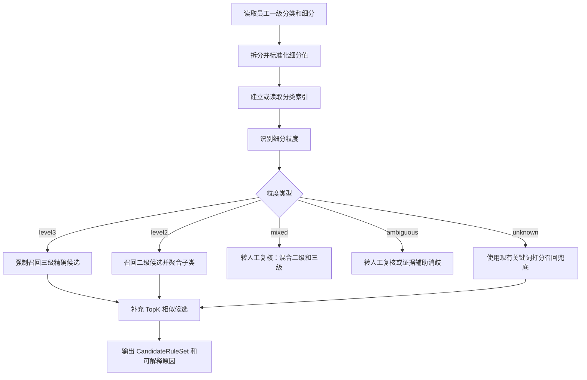

# Plan: 员工细分粒度识别与规则召回优化

**Generated**: 2026-07-31  
**Estimated Complexity**: Medium  
**Scope**: 解决员工 Excel 只有“一级分类”和“细分”两列时，细分可能是二级标题或三级标题，导致候选规则召回不稳定、二级分类被强行展开后受 TopK 截断的问题。  
**Non-Goals**: 本计划不调整部署架构，不引入付费外部 API，不改变员工 Excel 必填列结构。

## Overview

当前员工录入 Excel 的真实约束是：

```text
一级分类：必填
细分：必填
二级分类：不存在于员工 Excel
```

其中“细分”列有两种业务含义：

```text
情况 A：细分填的是二级标题，例如：医院
情况 B：细分填的是三级标题，例如：专科医院
```

但当前系统的规则候选单位主要是：

```text
level1 / level2 / level3
```

这会带来一个结构性问题：当员工填入的是二级标题时，系统会把该二级分类下的所有三级规则展开为候选，然后再受默认 Top5、最大 Top8 的限制。于是二级分类本身明明存在，却可能因为展开后的三级规则太多，表现成“没有 retrieve 到正确候选”或“候选不完整”。

本方案的核心不是继续无脑扩大 TopK，而是把召回分成两层：

```text
1. 先识别员工细分的粒度：level2 或 level3
2. 再按粒度使用不同召回策略：
   - level3：精确召回完整三级路径
   - level2：召回二级候选本身，并聚合其下三级规则作为辅助信息
```

目标是让系统从“只召回三级规则”升级为“支持二级候选和三级候选的统一分类候选模型”。

## Problem Analysis

### 问题 1: 员工细分粒度没有被显式识别

当前召回逻辑把员工 `entered_subcategory` 同时拿来匹配 `rule.level2` 和 `rule.level3`。这在简单场景下能工作，但系统没有明确记录：

```text
员工这次填的是二级分类
还是三级分类
```

因此后续 Classification Agent 只能看到若干三级候选规则，无法知道员工原始意图是“选择整个二级类目”还是“选择某个具体三级类目”。

### 问题 2: 二级分类被展开为三级规则后容易被 TopK 截断

例如员工填：

```text
一级分类 = 卫生和社会工作
细分 = 医院
```

规则库中可能存在：

```text
卫生和社会工作 / 医院 / 专科医院
卫生和社会工作 / 医院 / 民族医院
卫生和社会工作 / 医院 / 健康体检
卫生和社会工作 / 医院 / 医学影像诊断
...
```

如果 `医院` 下面有 12 个三级路径，而候选上限是 Top8，那么系统一定会截断。此时不是“医院不存在”，而是“二级候选被错误地用三级候选展开表达”。

### 问题 3: 分类表存在不等于最终候选一定能表达清楚

分类表里的完整规则是三级路径，但员工录入可能是二级粒度。当前 `CandidateRuleSet.candidates` 只保存 `CategoryRule` 列表，缺少候选粒度信息，导致下游无法区分：

```text
候选是员工精确填入的三级分类
还是员工填入二级分类后展开出来的三级分类
```

### 问题 4: 诊断信息还不够面向业务

当前已有 `entered_path_exists`、`raw_match_count`、`deduped_match_count`、`exact_match_count`、`truncated` 等字段，但还不能直接回答：

```text
员工细分命中的是二级还是三级？
如果命中二级，二级下面有多少三级？
哪些三级被展示，哪些因为 TopK 没展示？
这条记录能否只基于二级分类自动通过？
```

## Target Behavior

### 场景 1: 细分是三级标题

员工录入：

```text
一级分类 = 卫生和社会工作
细分 = 专科医院
```

规则库存在：

```text
卫生和社会工作 / 医院 / 专科医院
```

期望行为：

```text
1. 识别 entered_subcategory_granularity = level3
2. 强制召回 卫生和社会工作 / 医院 / 专科医院
3. 该候选不应被普通 TopK 挤掉
4. Classification Agent 可以基于该三级候选判断是否自动通过
```

### 场景 2: 细分是二级标题

员工录入：

```text
一级分类 = 卫生和社会工作
细分 = 医院
```

规则库存在多个三级子类：

```text
卫生和社会工作 / 医院 / 专科医院
卫生和社会工作 / 医院 / 民族医院
卫生和社会工作 / 医院 / 健康体检
...
```

期望行为：

```text
1. 识别 entered_subcategory_granularity = level2
2. 候选中明确保留二级候选：卫生和社会工作 / 医院
3. 三级子类作为 children 或 evidence_keywords 聚合信息存在
4. 不因为三级子类超过 Top8 就认为“员工分类不存在”
5. 如果证据只能证明企业属于医院行业，可以支持“二级分类正确”
6. 如果业务要求必须判断到三级，则转人工复核，并说明需要细化到三级
```

### 场景 3: 细分同时命中多个二级或三级

员工录入：

```text
一级分类 = 卫生和社会工作
细分 = 医院, 提供住宿社会工作
```

期望行为：

```text
1. 如果多个值都命中二级，则按二级候选列表处理
2. 如果多个值都命中三级，则按三级精确候选处理
3. 如果同一条数据中混入二级和三级，则转人工复核
4. 复核原因明确说明：同一单元格混合了二级标题和三级标题
```

## Proposed Design

### 1. 新增候选粒度模型

建议在 `D:\audit-agent\app\domain\models.py` 中新增轻量模型：

```python
class CandidateCategory(BaseModel):
    """分类候选：支持员工细分命中二级或三级两种粒度。"""

    level1: str
    level2: str
    level3: str = ""
    granularity: str  # level2 或 level3
    matched_entered_value: str
    child_count: int = 0
    children: list[CategoryRule] = Field(default_factory=list)
    keywords: list[str] = Field(default_factory=list)
```

保留现有 `CandidateRuleSet.candidates` 作为兼容字段，新增：

```python
category_candidates: list[CandidateCategory] = Field(default_factory=list)
entered_subcategory_granularity: str = "unknown"
granularity_reason: str = ""
```

这样旧流程仍能读取三级规则，新流程可以读取更准确的分类候选。

### 2. 建立分类路径索引

在 `D:\audit-agent\app\services\rule_retriever.py` 中新增内部索引结构：

```python
@dataclass
class CategoryIndex:
    level2_by_key: dict[tuple[str, str], list[CategoryRule]]
    level3_by_key: dict[tuple[str, str], list[CategoryRule]]
    full_path_by_key: dict[tuple[str, str, str], list[CategoryRule]]
```

索引含义：

```text
level2_by_key[(level1, level2)] = 该二级分类下所有规则
level3_by_key[(level1, level3)] = 该三级分类对应的规则
full_path_by_key[(level1, level2, level3)] = 完整路径规则
```

注意：`level3_by_key` 可能命中多个路径，因为同名三级可能出现在不同二级下。此时需要：

```text
1. 如果同一个 level1 下 level3 只属于一个 level2，则可自动识别为三级
2. 如果同一个 level1 下 level3 属于多个 level2，则标记 ambiguous，转人工复核或使用证据辅助 disambiguation
```

### 3. 新增细分粒度识别函数

建议新增：

```python
def classify_entered_subcategory_granularity(
    audit_case: AuditCase,
    rules: list[CategoryRule],
) -> EnteredSubcategoryMatchResult:
    """识别员工细分列填的是二级标题还是三级标题。"""
```

返回结构建议：

```python
@dataclass
class EnteredSubcategoryMatchResult:
    granularity: str  # level2, level3, mixed, unknown, ambiguous
    level2_matches: list[CandidateCategory]
    level3_matches: list[CandidateCategory]
    unmatched_values: list[str]
    ambiguous_values: list[str]
    reason: str
```

判断规则：

```text
1. 拆分 entered_subcategory 中的多个值
2. 对每个值做标准化
3. 先查 (level1, value) 是否是二级分类
4. 再查 (level1, value) 是否是三级分类
5. 如果只命中二级：标记 level2
6. 如果只命中三级：标记 level3
7. 如果同时命中二级和三级：标记 ambiguous
8. 如果多个值中既有二级又有三级：标记 mixed
9. 如果都不命中：标记 unknown
```

### 4. 改造召回策略

召回流程调整为：



### 5. Classification Agent 判断逻辑调整

在 `D:\audit-agent\app\agents\classification_agent.py` 中增加粒度意识：

```text
如果员工填的是三级：
  - 证据需要支持该三级分类，才能自动通过

如果员工填的是二级：
  - 证据支持该二级行业即可认为分类方向正确
  - 如果业务要求必须精确到三级，则转人工复核
  - 不应该因为无法确定三级子类而直接判为“证据不足”

如果粒度 mixed 或 ambiguous：
  - 默认转人工复核
  - reason 里说明录入粒度不一致或分类存在歧义
```

建议增加配置：

```text
ALLOW_LEVEL2_AUTO_APPROVAL=true
```

默认建议为 `true`。因为员工 Excel 允许细分填二级标题，系统就应该承认二级分类是合法输入粒度。若后续业务要求必须到三级，可将该配置改为 `false`。

## Sprint 1: 固化问题复现和目标行为

**Goal**: 用测试明确“细分可为二级或三级”的业务规则，防止后续实现偏离真实输入模型。  
**Demo/Validation**:

- 新增测试能证明二级细分不会被误判为不存在。
- 新增测试能证明三级细分会被精确召回。
- 新增测试能证明混合粒度会转人工复核。

### Task 1.1: 增加三级细分精确召回测试

- **Location**: `D:\audit-agent\tests\unit\test_rule_retriever.py`
- **Description**: 构造员工录入 `一级分类=卫生和社会工作`、`细分=专科医院`，规则库存在 `卫生和社会工作 / 医院 / 专科医院`。
- **Dependencies**: 无
- **Acceptance Criteria**:
  - `entered_subcategory_granularity == "level3"`
  - `category_candidates` 包含 `卫生和社会工作 / 医院 / 专科医院`
  - 该候选不会因为普通 TopK 排序被挤掉
- **Validation**:
  - 新增测试：`test_retrieve_identifies_entered_subcategory_as_level3`

### Task 1.2: 增加二级细分召回测试

- **Location**: `D:\audit-agent\tests\unit\test_rule_retriever.py`
- **Description**: 构造员工录入 `一级分类=卫生和社会工作`、`细分=医院`，规则库下存在多个医院三级子类。
- **Dependencies**: 无
- **Acceptance Criteria**:
  - `entered_subcategory_granularity == "level2"`
  - `category_candidates` 包含二级候选 `卫生和社会工作 / 医院`
  - `child_count` 等于该二级下去重后的三级数量
  - 不因为三级子类超过 Top8 而将 `entered_path_exists` 置为 `False`
- **Validation**:
  - 新增测试：`test_retrieve_identifies_entered_subcategory_as_level2`

### Task 1.3: 增加混合粒度测试

- **Location**: `D:\audit-agent\tests\unit\test_rule_retriever.py`
- **Description**: 构造同一个细分单元格中同时出现二级和三级标题的情况。
- **Dependencies**: 无
- **Acceptance Criteria**:
  - `entered_subcategory_granularity == "mixed"`
  - 召回原因中明确提示“同一条记录混合二级和三级分类”
  - 后续分类决策应进入人工复核
- **Validation**:
  - 新增测试：`test_retrieve_marks_mixed_level2_and_level3_values`

### Task 1.4: 增加歧义三级测试

- **Location**: `D:\audit-agent\tests\unit\test_rule_retriever.py`
- **Description**: 构造同一个三级名称在同一一级分类下属于多个二级分类的规则。
- **Dependencies**: 无
- **Acceptance Criteria**:
  - `entered_subcategory_granularity == "ambiguous"`
  - `ambiguous_values` 包含该细分值
  - 结果不得自动通过
- **Validation**:
  - 新增测试：`test_retrieve_marks_ambiguous_level3_name`

## Sprint 2: 实现分类索引和粒度识别

**Goal**: 在不破坏现有召回结果的前提下，新增粒度识别能力。  
**Demo/Validation**:

- Sprint 1 中的召回粒度测试通过。
- 现有 `test_rule_retriever.py` 测试继续通过。

### Task 2.1: 新增分类文本标准化函数

- **Location**: `D:\audit-agent\app\services\rule_retriever.py`
- **Description**: 新增 `_normalize_category_text(value)`，统一处理空格、全角空格、换行、大小写和常见中文标点。
- **Dependencies**: Sprint 1
- **Acceptance Criteria**:
  - 比较分类路径时使用标准化后的值
  - 不改变最终展示给用户的原始分类名称
  - 中文逗号、顿号、分号、斜杠、换行可以正确拆分多个细分值
- **Validation**:
  - 增加单元测试覆盖 `专科医院 `、`专科医院\n`、`专科医院、民族医院`

### Task 2.2: 新增 CategoryIndex

- **Location**: `D:\audit-agent\app\services\rule_retriever.py`
- **Description**: 根据规则库构建一级、二级、三级索引，索引 key 使用标准化文本。
- **Dependencies**: Task 2.1
- **Acceptance Criteria**:
  - 支持通过 `(level1, level2)` 查询二级下所有规则
  - 支持通过 `(level1, level3)` 查询三级对应规则
  - 支持通过 `(level1, level2, level3)` 查询完整路径
- **Validation**:
  - 增加测试：`test_category_index_finds_level2_and_level3_matches`

### Task 2.3: 新增细分粒度识别函数

- **Location**: `D:\audit-agent\app\services\rule_retriever.py`
- **Description**: 实现 `classify_entered_subcategory_granularity()`，根据索引判断细分值属于二级、三级、混合、未知或歧义。
- **Dependencies**: Task 2.2
- **Acceptance Criteria**:
  - 全部值命中二级时返回 `level2`
  - 全部值命中三级时返回 `level3`
  - 同时出现二级和三级时返回 `mixed`
  - 单个值同时可能是二级和三级时返回 `ambiguous`
  - 无命中时返回 `unknown`
- **Validation**:
  - Sprint 1 中四个测试通过

## Sprint 3: 扩展候选模型并保持向后兼容

**Goal**: 让候选结果能表达二级分类，不再只能表达三级规则。  
**Demo/Validation**:

- API 和前端旧字段仍可读取。
- 新字段可以清楚展示候选粒度和匹配原因。

### Task 3.1: 新增 CandidateCategory 模型

- **Location**: `D:\audit-agent\app\domain\models.py`
- **Description**: 新增支持二级和三级粒度的候选模型。
- **Dependencies**: Sprint 2
- **Acceptance Criteria**:
  - `granularity` 只能是 `level2` 或 `level3`
  - 二级候选允许 `level3=""`
  - 三级候选必须包含 `level3`
  - 支持保存 `matched_entered_value`、`child_count`、`keywords`
- **Validation**:
  - 更新 `D:\audit-agent\tests\unit\test_domain_models.py`

### Task 3.2: 扩展 CandidateRuleSet

- **Location**: `D:\audit-agent\app\domain\models.py`
- **Description**: 在 `CandidateRuleSet` 中新增粒度相关字段，同时保留 `candidates` 旧字段。
- **Dependencies**: Task 3.1
- **Acceptance Criteria**:
  - 新增 `category_candidates`
  - 新增 `entered_subcategory_granularity`
  - 新增 `granularity_reason`
  - 旧调用方不需要立刻修改也不会报错
- **Validation**:
  - 现有领域模型测试和 workflow 测试通过

### Task 3.3: 构造二级候选

- **Location**: `D:\audit-agent\app\services\rule_retriever.py`
- **Description**: 当细分识别为二级时，生成 `CandidateCategory(granularity="level2")`，并把该二级下的三级规则作为 children 或聚合关键词。
- **Dependencies**: Task 3.2
- **Acceptance Criteria**:
  - 二级候选不会被 TopK 截断
  - `child_count` 正确
  - `children` 中的三级规则按路径去重
  - `keywords` 合并去重，供证据匹配和 LLM 判断使用
- **Validation**:
  - `test_retrieve_identifies_entered_subcategory_as_level2` 通过

### Task 3.4: 构造三级候选

- **Location**: `D:\audit-agent\app\services\rule_retriever.py`
- **Description**: 当细分识别为三级时，生成 `CandidateCategory(granularity="level3")`，并同步补充旧字段 `candidates`。
- **Dependencies**: Task 3.2
- **Acceptance Criteria**:
  - 三级候选精确进入 `category_candidates`
  - 对应规则进入旧字段 `candidates`
  - 多个三级细分全部保留，最多受配置上限保护
- **Validation**:
  - `test_retrieve_identifies_entered_subcategory_as_level3` 通过

## Sprint 4: 调整 Classification Agent 决策逻辑

**Goal**: 让 Classification Agent 理解二级候选和三级候选的不同判断标准。  
**Demo/Validation**:

- 二级分类可按二级证据判断正确。
- 三级分类仍按三级证据判断正确。
- 混合和歧义场景进入人工复核。

### Task 4.1: 增加二级候选判断分支

- **Location**: `D:\audit-agent\app\agents\classification_agent.py`
- **Description**: 如果 `entered_subcategory_granularity == "level2"`，判断证据是否支持该二级分类，而不是要求证据必须支持某个三级子类。
- **Dependencies**: Sprint 3
- **Acceptance Criteria**:
  - 证据包含二级关键词时可以自动通过
  - 不因无法确定三级子类而返回“证据不足”
  - reason 明确说明“员工录入为二级分类，证据支持该二级分类”
- **Validation**:
  - 新增测试：`test_classification_accepts_supported_level2_category`

### Task 4.2: 保持三级候选严格判断

- **Location**: `D:\audit-agent\app\agents\classification_agent.py`
- **Description**: 如果 `entered_subcategory_granularity == "level3"`，继续要求证据支持具体三级分类。
- **Dependencies**: Task 4.1
- **Acceptance Criteria**:
  - `专科医院` 这类三级分类仍需命中三级相关证据或关键词
  - 不因为只命中 `医院` 就自动通过 `专科医院`
- **Validation**:
  - 新增测试：`test_classification_requires_level3_evidence_for_level3_input`

### Task 4.3: 混合和歧义场景进入人工复核

- **Location**: `D:\audit-agent\app\agents\classification_agent.py`
- **Description**: 对 `mixed`、`ambiguous`、`unknown` 粒度输出稳定的人工复核结论。
- **Dependencies**: Task 4.1
- **Acceptance Criteria**:
  - `mixed`：提示同一细分单元格混合二级和三级分类
  - `ambiguous`：提示分类名称存在多个可能路径
  - `unknown`：提示细分不在当前规则库中
  - 三类场景都不得自动通过
- **Validation**:
  - 新增测试：`test_classification_routes_mixed_or_ambiguous_granularity_to_review`

## Sprint 5: API、前端和导出结果增强

**Goal**: 让审核人员能看懂系统到底按二级还是三级判断。  
**Demo/Validation**:

- 页面结果中展示召回粒度。
- Excel 导出中展示候选分类路径和粒度原因。

### Task 5.1: API 响应增加粒度字段

- **Location**:
  - `D:\audit-agent\app\api\schemas.py`
  - `D:\audit-agent\app\api\routes.py`
- **Description**: 在批次详情或结果响应中增加粒度字段。
- **Dependencies**: Sprint 4
- **Acceptance Criteria**:
  - 返回 `entered_subcategory_granularity`
  - 返回 `granularity_reason`
  - 返回 `category_candidate_paths`
- **Validation**:
  - 更新 `D:\audit-agent\tests\unit\test_audit_api.py`

### Task 5.2: 前端展示粒度和候选

- **Location**: `D:\audit-agent\app\static\app.js`
- **Description**: 在结果表中展示“召回粒度”和“候选分类”，方便定位问题。
- **Dependencies**: Task 5.1
- **Acceptance Criteria**:
  - 二级候选显示为 `卫生和社会工作 / 医院`
  - 三级候选显示为 `卫生和社会工作 / 医院 / 专科医院`
  - mixed、ambiguous、unknown 有清晰状态文案
- **Validation**:
  - 浏览器手工验证上传样例 Excel 后结果展示正确

### Task 5.3: Excel 导出增加召回诊断列

- **Location**: `D:\audit-agent\app\infrastructure\excel_writer.py`
- **Description**: 在结果 Excel 中增加粒度、候选路径、召回原因列。
- **Dependencies**: Task 5.1
- **Acceptance Criteria**:
  - 导出结果包含“细分粒度”
  - 导出结果包含“候选分类”
  - 导出结果包含“召回原因”
- **Validation**:
  - 更新 `D:\audit-agent\tests\unit\test_excel_writer.py`

## Sprint 6: 评估集和回归验证

**Goal**: 用真实业务场景防止召回策略再次退化。  
**Demo/Validation**:

- 新增 eval case 覆盖二级、三级、混合、歧义、未知。
- 运行全量测试和 eval。

### Task 6.1: 增加二级分类样例

- **Location**: `D:\audit-agent\evals`
- **Description**: 增加员工细分为二级标题的样例，例如 `卫生和社会工作 / 医院`。
- **Dependencies**: Sprint 5
- **Acceptance Criteria**:
  - 系统能识别二级粒度
  - 证据支持二级时自动通过
- **Validation**:
  - `D:\audit-agent\.venv\Scripts\python.exe scripts\run_eval.py --min-accuracy 0.8`

### Task 6.2: 增加三级分类样例

- **Location**: `D:\audit-agent\evals`
- **Description**: 增加员工细分为三级标题的样例，例如 `卫生和社会工作 / 专科医院`。
- **Dependencies**: Task 6.1
- **Acceptance Criteria**:
  - 系统能识别三级粒度
  - 证据支持三级时自动通过
  - 证据只支持二级时不自动通过三级
- **Validation**:
  - eval 准确率不低于既定阈值

### Task 6.3: 增加异常录入样例

- **Location**: `D:\audit-agent\evals`
- **Description**: 增加 mixed、ambiguous、unknown 三类样例。
- **Dependencies**: Task 6.2
- **Acceptance Criteria**:
  - mixed 转人工复核
  - ambiguous 转人工复核
  - unknown 转人工复核或证据不足
- **Validation**:
  - 检查每类样例的 reason 是否可解释

## Testing Strategy

### Unit Tests

重点覆盖：

```text
1. 分类文本标准化
2. 细分拆分
3. 分类索引构建
4. 二级粒度识别
5. 三级粒度识别
6. mixed / ambiguous / unknown 判断
7. CandidateCategory 模型校验
8. Classification Agent 对不同粒度的决策分支
```

建议命令：

```powershell
D:\audit-agent\.venv\Scripts\python.exe -m pytest tests\unit\test_rule_retriever.py
D:\audit-agent\.venv\Scripts\python.exe -m pytest tests\unit\test_classification_agent.py
```

### Integration Tests

重点覆盖：

```text
1. 上传 Excel 后 workflow 能正确识别粒度
2. 批次结果能展示粒度和候选路径
3. Excel 导出结果包含召回诊断
```

建议命令：

```powershell
D:\audit-agent\.venv\Scripts\python.exe -m pytest tests\integration
```

### Full Verification

最终合并前运行：

```powershell
D:\audit-agent\.venv\Scripts\python.exe -m pytest
D:\audit-agent\.venv\Scripts\python.exe -m ruff check .
D:\audit-agent\.venv\Scripts\python.exe scripts\run_eval.py --min-accuracy 0.8
```

## Acceptance Criteria

整体完成后需要满足：

```text
1. 员工细分填二级标题时，系统能明确识别为 level2
2. 员工细分填三级标题时，系统能明确识别为 level3
3. 二级候选不会因为三级子类超过 Top8 而丢失
4. 三级候选仍保持精确召回和严格判断
5. mixed、ambiguous、unknown 不自动通过
6. 页面、API、导出结果都能展示召回粒度和原因
7. 原有 Top5 / Top8 动态召回策略继续兼容
8. 全量单元测试、集成测试和 eval 通过
```

## Potential Risks & Gotchas

### 风险 1: 同名三级分类可能存在多条路径

例如同一个三级标题在不同二级分类下都存在。此时不能只凭三级名称自动通过。

**Mitigation**:

```text
1. 在索引阶段识别歧义
2. 如果无法用一级分类唯一定位，则标记 ambiguous
3. 默认转人工复核
```

### 风险 2: 二级分类自动通过的业务边界需要确认

如果员工填的是二级标题，证据只证明该企业属于二级行业，但不能证明具体三级子类。是否允许自动通过取决于业务要求。

**Mitigation**:

```text
1. 增加配置 ALLOW_LEVEL2_AUTO_APPROVAL
2. 默认建议 true，因为员工 Excel 允许细分填二级标题
3. 如果业务以后要求必须到三级，可配置为 false
```

### 风险 3: 旧字段 candidates 仍是三级规则

为了兼容旧流程，`CandidateRuleSet.candidates` 还会存在。如果下游只读旧字段，可能仍无法理解二级候选。

**Mitigation**:

```text
1. 新增 category_candidates
2. Classification Agent 优先读取 category_candidates
3. 旧 candidates 仅作为兼容和补充
```

### 风险 4: 规则库重复路径较多

当前正式规则库中存在较多重复完整路径。如果二级候选 children 不去重，仍会出现候选膨胀。

**Mitigation**:

```text
1. children 按 level1 / level2 / level3 去重
2. module 和 keywords 合并
3. 展示时显示分类路径，不展示重复 module 规则
```

### 风险 5: 细分分隔符不统一

员工可能使用中文逗号、顿号、分号、斜杠、换行等方式录入多个细分。

**Mitigation**:

```text
1. 统一拆分函数
2. 单元测试覆盖常见分隔符
3. 保留原始录入文本用于审计追踪
```

## Rollback Plan

如果上线后出现异常，可以按以下方式回滚：

```text
1. Classification Agent 暂时忽略 category_candidates，恢复读取旧 candidates
2. 保留新增字段但不参与决策，避免 API 兼容性问题
3. 将 ALLOW_LEVEL2_AUTO_APPROVAL 设置为 false，让二级粒度进入人工复核
4. 回退 rule_retriever 中的粒度识别分支，仅保留原有 Top5 / Top8 召回
```

## Recommended Implementation Order

建议按以下顺序实施：

```text
1. 先写 Sprint 1 的行为测试
2. 再实现 Sprint 2 的分类索引和粒度识别
3. 然后扩展 CandidateRuleSet，保持旧字段兼容
4. 接着改 Classification Agent，让它优先读新候选模型
5. 最后补 API、前端、Excel 导出和 eval
```

这样每一步都有可验证结果，也不会一次性破坏当前已经优化好的动态 TopK 召回逻辑。
